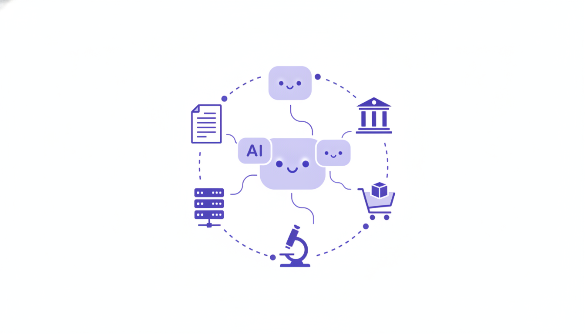
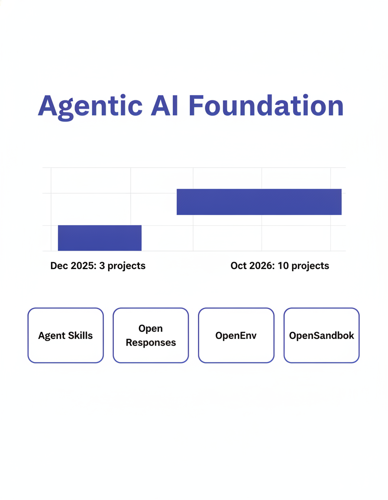
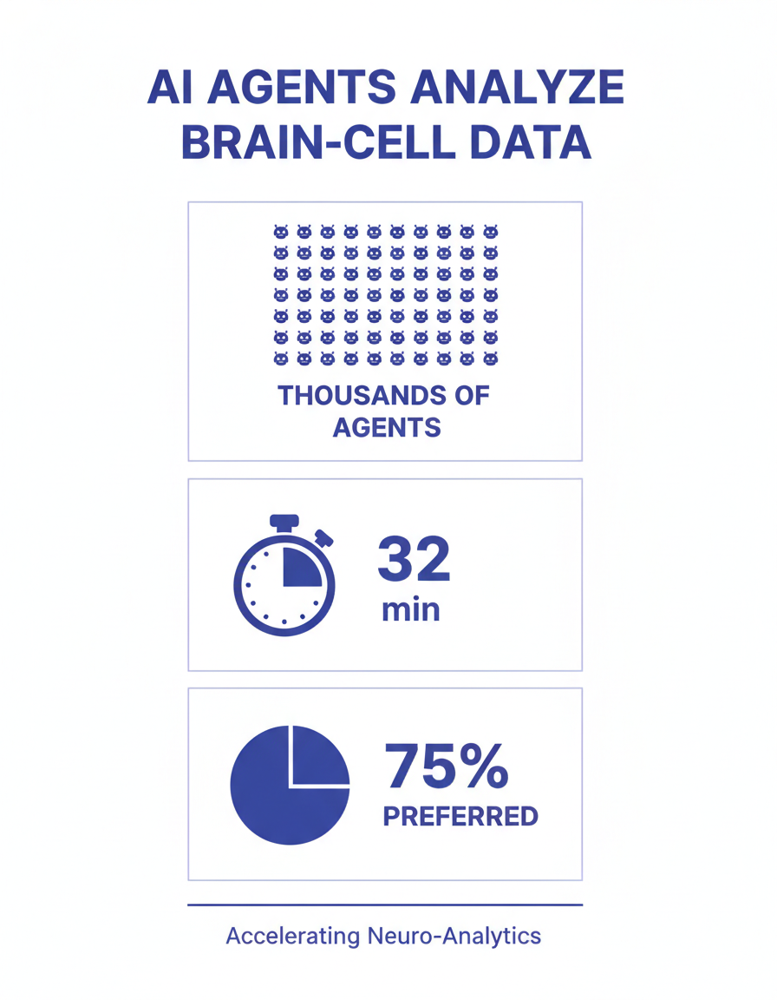
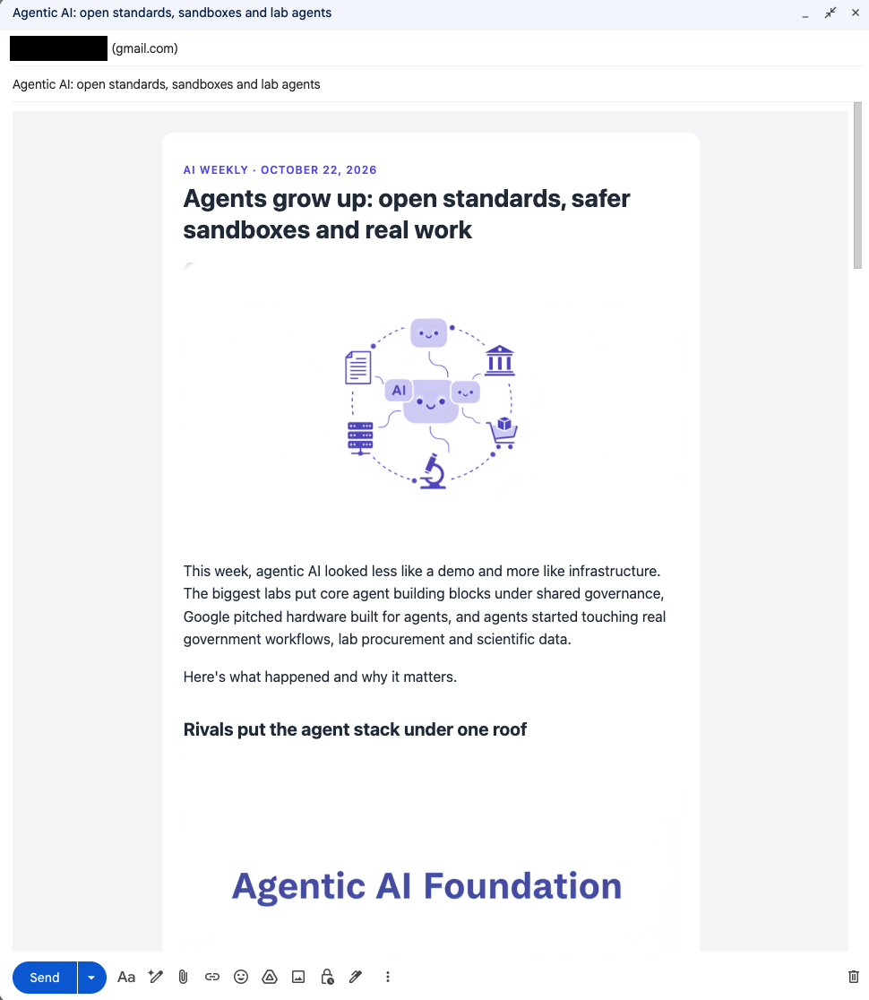

# Example: Agentic AI newsletter (October 22, 2026)

A real run of Newsletter Automation, from a one-line prompt to a Gmail draft.

## The prompt

In Claude Code, opened in the `newsletter-automation` folder:

> write a newsletter about Agentic AI

That's all. Claude followed [`workflows/create_newsletter.md`](../../workflows/create_newsletter.md) and ran each tool in order.

## What happened behind the scenes

### 1. Research (Perplexity Agent API)

```bash
python tools/research_topic.py \
  --topic "Agentic AI: the latest news, product launches, research, funding and enterprise adoption of AI agents" \
  --recency week \
  --out .tmp/2026-10-22-agentic-ai/research.json
```

Perplexity returned 8 cited stories from the past week. Cost: about $0.02.

### 2. Writing (Claude)

Claude picked 6 of the stories, dropping one that was 3 weeks old, and wrote [`content.json`](content.json): subject line, intro, sections with a "why it matters" for each story, key takeaways and sources. Every fact comes from the research.

### 3. Infographics (Nano Banana via Kie.ai)

Three images, generated in parallel in about 20 seconds:

| Image | Prompt |
|-------|--------|
|  | *Clean, modern editorial header illustration for a newsletter about agentic AI. Several friendly abstract AI agent icons (rounded geometric shapes with small glowing 'eye' dots) working together, connected by lines to tool icons: a document, a server, a shopping cart, a microscope, a government building. Flat vector style, white background, indigo (#4f46e5) and soft lavender accent colors, generous whitespace. No text, no logos.* (16:9) |
|  | *Clean, modern editorial infographic. Title at top: 'Agentic AI Foundation'. A simple bar chart with two bars: left bar short labeled 'Dec 2025: 3 projects', right bar tall labeled 'Oct 2026: 10 projects'. Below, four small cards labeled exactly: 'Agent Skills', 'Open Responses', 'OpenEnv', 'OpenSandbox'. Flat vector style, white background, indigo (#4f46e5) accent color, large legible sans-serif labels, minimal text, no logos.* (4:5) |
|  | *Clean, modern editorial infographic about AI agents analyzing brain-cell data. Three large stat blocks stacked vertically with simple icons: a grid of many small robot icons with label 'Thousands of agents'; a stopwatch icon with big number '32 min'; a pie chart 75% filled with label '75% preferred'. Flat vector style, white background, indigo (#4f46e5) accent color, large legible sans-serif labels, minimal text, no logos.* (4:5) |

Note: infographic 1 came out as "OpenSandbok" instead of "OpenSandbox". Image models still misspell words, so keep in-image text short and check every image.

### 4. HTML rendering

```bash
python tools/render_newsletter.py --content .tmp/2026-10-22-agentic-ai/content.json
```

### 5. Gmail draft

```bash
python tools/create_gmail_draft.py --content .tmp/2026-10-22-agentic-ai/content.json
```

## The output

**Subject:** Agentic AI: open standards, sandboxes and lab agents



**Stories in the issue:**
1. Rivals put the agent stack under one roof (Linux Foundation's Agentic AI Foundation)
2. Google builds a computer for every agent (Agent Compute Engine)
3. Gemini agents head to government
4. Thousands of agents, 32 minutes, new biology leads (OpenAI, PerturbAI, Scripps Research)
5. From research plan to purchase order (Scientist.com)
6. Follow the money: back-office agents and agent oversight (Leena AI, Asymptote Labs)

The full text is in [`content.json`](content.json).
