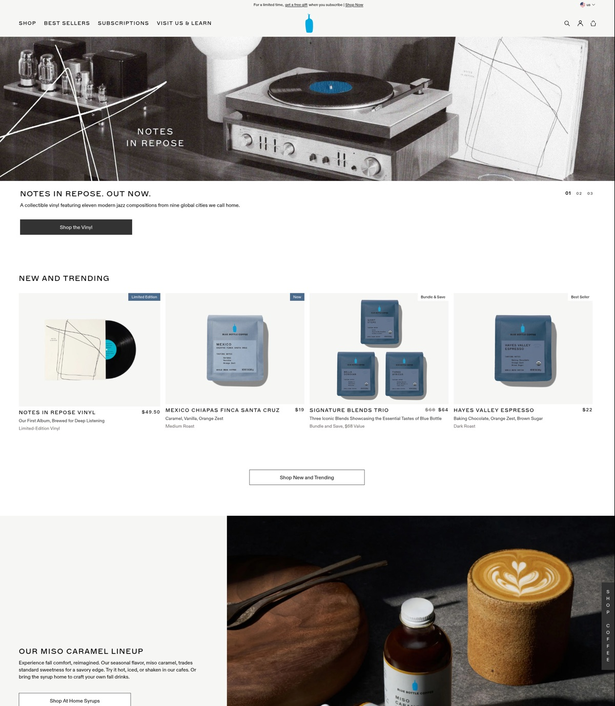

# Example: Blue Bottle Coffee site map + homepage look (October 22, 2026)

A real run of Scrapper: one URL in, and out comes every indexed page on the site grouped by purpose, a full-page screenshot, and a shareable page that puts the two side by side.

## The prompt

In Claude Code:

> Mapout this site for me and show me what it looks like
> https://bluebottlecoffee.com/us/eng

## What happened behind the scenes

### 1. Screenshot + homepage content (1 Firecrawl call)

```json
{
  "url": "https://bluebottlecoffee.com/us/eng",
  "formats": ["screenshot", "markdown"],
  "screenshotOptions": { "fullPage": true },
  "onlyMainContent": false
}
```

- `onlyMainContent: false` keeps the header and footer in the markdown. That's where the primary nav and footer link groups come from.
- `screenshot` returned a signed URL to a 1920×8810 PNG. It was downloaded right away because these URLs expire.

### 2. Every URL on the site (1 Firecrawl call)

```json
{
  "url": "https://bluebottlecoffee.com/us/eng",
  "limit": 1000,
  "ignoreQueryParameters": true
}
```

`firecrawl_map` returned **452 URLs**, each with a title and sometimes a description. The response was too large to show inline, so it was saved to disk and processed with Python.

### 3. Group the URLs

A short Python step split each path on `/` and grouped it by its first segment (`product`, `collection`, `cafes`, ...). Claude then sorted the 60-odd top-level paths into six groups by what the page is for: Shop, Visit us, Learn, Campaigns, Sign-ups and waitlists, and Account and support.

### 4. Build the page

The grouped data and a compressed JPEG of the screenshot were put into a single self-contained HTML file (about 650KB) and published as a private Claude artifact.

## The output

| File | What's in it |
|------|--------------|
| [`sitemap.html`](sitemap.html) | The final page: a filterable site tree on the left and a scrollable homepage screenshot on the right. Open it in a browser. |
| [`urls.json`](urls.json) | Raw `firecrawl_map` output: 452 URLs with titles and descriptions |
| [`sitemap-grouped.json`](sitemap-grouped.json) | Child pages by top-level path |
| [`screenshots/fullpage.jpg`](screenshots/fullpage.jpg) | The whole homepage, resized to 1200px wide |
| [`screenshots/section-1.jpg`](screenshots/section-1.jpg) | Nav, vinyl hero, New and Trending |
| [`screenshots/section-2.jpg`](screenshots/section-2.jpg) | Miso caramel feature, Shop by Collection |
| [`screenshots/section-3.jpg`](screenshots/section-3.jpg) | Craft Matcha, subscriptions, cafes and membership |
| [`screenshots/section-4.jpg`](screenshots/section-4.jpg) | Brew guides, reviews, footer |



### Site map

| Group | What's in it |
|---|---|
| **Shop** | 113 product pages (`/product/…`), 116 collections (`/collection/…`), 35 category pages (`/shop/…`), subscription plans and gift guides |
| **Visit us** | `/cafes` plus 108 pages for single cafes in the US, Japan and Korea, 7 regional pages (Northern California, New York, Chicago and others), and membership |
| **Learn** | 17 brew guides (pour over, Chemex, moka pot, nel drip and others), plus Our Story, Our Coffee, sustainability, Blue Bottle Studio and careers |
| **Campaigns** | Launch pages: NOLA, Samra Origins, Cold by Design, the Marimekko collaboration, Month of Jazz |
| **Sign-ups and waitlists** | Email sign-up pages, confirmation pages and waitlists |
| **Account and support** | Cart, checkout, account, search, FAQ and legal pages |

**Primary nav:** Shop ▾, Best Sellers, Subscriptions, Visit Us & Learn ▾, plus search, account, cart and a country picker (US, CA, JP, KR).

### What the homepage looks like

It's a minimal, photo-led design. Section headings are small, uppercase and widely spaced. The page alternates white and pale grey bands, product photos are shot on stone and wood, and the only color is the blue of the bottle logo. From top to bottom:

1. A promo bar, then a 3-slide hero carousel led by the *Notes in Repose* jazz vinyl.
2. A "New and Trending" product carousel.
3. Miso caramel syrups, then four "Shop by Collection" tiles.
4. Craft Matcha, then the Blue Bottle at Home subscription pitch.
5. A cafe carousel and membership, brew guides, and a customer reviews strip.
6. A dark charcoal footer.

**Cost:** 2 Firecrawl credits (1 scrape + 1 map).

## Lessons from this run

- **Map + one screenshot scrape is enough for "map this site and show me".** No crawl was needed. Map gives you the URL inventory, and one scrape gives you the visuals and the nav structure.
- **Map's index includes stale URLs.** Old collections such as holiday 2023 and Lunar New Year still show up. Some may now redirect or no longer exist, so treat counts as "indexed", not "live".
- **Large map results get saved to a file.** Read them with a script rather than in the conversation.
- **Shrink the screenshot before embedding or committing it.** The raw PNG was 6.8MB. A JPEG at 1200px wide is under 1MB and still readable.
- **Slice with an explicit top offset.** `sips -c <h> <w> --cropOffset <y> 1` with the y offset computed for each slice gave clean top-to-bottom sections.
