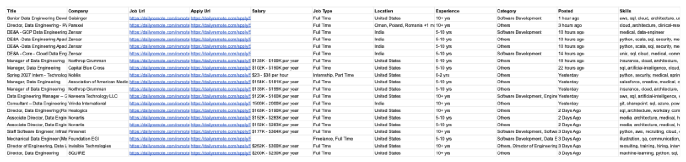

# Example: DailyRemote data engineering jobs → Google Sheet (October 22, 2026)

A real run of Scrapper, from a job-board link to a Google Sheet of 20 structured job listings.

## The prompt

In Claude Code, opened in the `scrapper` folder:

> I found this website, and I've got about 1,700 job opportunities that I want to look at... I want these as structured data so I could maybe just throw them into a Google Sheet.
> https://dailyremote.com/?search=data+engineering&page=1#main

Claude scraped one page with the Firecrawl MCP to see how it was built before planning, then asked three questions:

| Question | Answer |
|----------|--------|
| The search shows **249** jobs, not about 1,700. Which set? | Only the first 20 |
| Open each job's own page too? | Yes |
| CSV to import, or push straight to Google Sheets? | Push straight to a Google Sheet |

## What the probe found

- Listing cards say **"Company hidden"** (DailyRemote's premium paywall). The company name only appears on each job's detail page, which is why every job is opened.
- Each card packs location, salary, experience and category onto one line with no separators:
  `United States$133K - $199K per year5-10 yrs exp [Others]`
- Salary is on the card, not reliably on the detail page, and isn't always in USD (`1500K - 2000K per year` for India).
- One markdown scrape costs **1 Firecrawl credit**.

## What happened behind the scenes

Claude followed [`workflows/scrape_dailyremote.md`](../../workflows/scrape_dailyremote.md). Since 21 pages of raw markdown would flood the conversation, the scraping runs in a Python tool that calls the Firecrawl REST API rather than the MCP.

### 1. Test run (2 jobs, 3 credits)

```bash
python tools/scrape_dailyremote.py --search "data engineering" --limit 2
```

This checks that company, apply link and description parse correctly before spending the full budget.

### 2. Full run (20 jobs, 19 credits)

```bash
python tools/scrape_dailyremote.py --search "data engineering" --limit 20
```

1 listing page plus 18 new detail pages. The 2 from the test run were reused from cache. Output: [`jobs.csv`](jobs.csv).

### 3. Push to Google Sheets

```bash
python tools/push_to_sheets.py --csv .tmp/dailyremote/jobs.csv
```

The first run opens a Google sign-in for Sheets access. It creates the spreadsheet, makes the header row bold and keeps it visible when scrolling, and sets column widths and row heights.

## The output

**Sheet:** "DailyRemote – Data Engineering – 2026-10-22", 20 rows × 16 columns.



*Columns Title through Skills shown. The sheet also has Job ID, Summary, Description (full posting text), Scrape Status and Scraped At.*

**By the numbers:**
- 20 of 20 rows have company, apply link, location, experience and full description.
- 13 of 20 have a salary. The other 7 listings don't publish one.
- 15 distinct companies, including Geisinger, Parexel, Zensar, Northrop Grumman, Novartis, Pinterest and Invisible Technologies.
- Salaries range from $23–38/hour (an internship) up to $177K–$364K/year (a Staff Engineer role at Pinterest).

**Cost:** 24 Firecrawl credits in total (2 probing + 3 test + 19 full run). Google Sheets is free.

## Lessons from this run

- **Check the count first.** The user expected about 1,700 jobs. The search actually had 249. A single scrape caught this before any money was spent.
- **The salary regex must end at a unit** (`per year|hour|...`). A greedy `per \w+` swallowed the first digit of the experience ("per year1" + "0+ yrs").
- **Line breaks make rows tall.** Even with clipped text, Sheets grows a row to fit line breaks inside a cell. The first version put about 800px-tall rows in the sheet. `push_to_sheets.py` now pins data rows to 21px.
- **Some postings are near-duplicates.** Novartis and Northrop Grumman each list the same role twice under different IDs. Both are kept, since they're separate listings.
