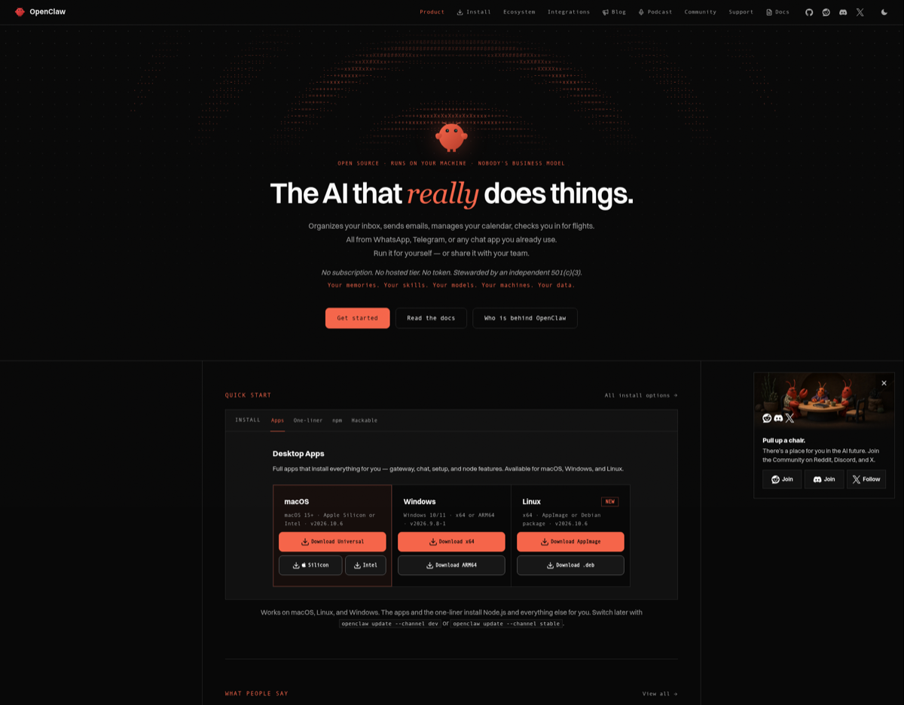
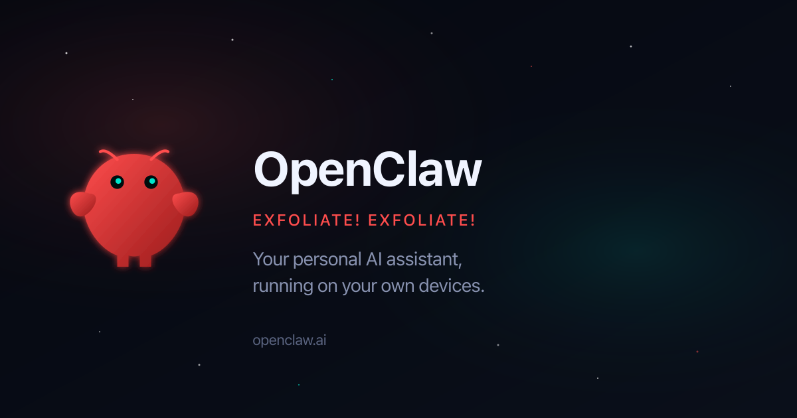

# Example: clawd.bot screenshots → branding breakdown (October 22, 2026)

A real run of Scrapper: from a single URL to full-page screenshots and a plain-English explanation of a site's brand.

## The prompt

In Claude Code:

> please grab screenshots of this page and help me undertand branding
> clawd.bot

## What happened behind the scenes

### 1. One scrape, three formats (1 Firecrawl call)

A single `firecrawl_scrape` call through the MCP:

```json
{
  "url": "https://clawd.bot",
  "formats": ["screenshot", "branding", "markdown"],
  "screenshotOptions": { "fullPage": true }
}
```

- **`clawd.bot` redirects to `openclaw.ai`.** The project was renamed from Clawdbot to **OpenClaw**, so everything below describes the OpenClaw brand.
- `branding` returned colors, fonts, button styles, spacing, logo and OG image URLs, plus a guess at personality. Saved as [`branding.json`](branding.json).
- `screenshot` returned a signed URL to a 1920×7515 full-page PNG. These URLs expire, so the image was downloaded right away.

### 2. Download the assets

The screenshot, `og-image.png` and `favicon.svg` (the logo) were fetched with `curl`.

### 3. Slice the screenshot so it can be read

A 7,515px-tall image is too tall to read in one go, so it was cut into five 1,500px sections with macOS `sips`, each resized to 1,200px wide.

## The output

### Screenshots

| File | What's in it |
|------|--------------|
| [`fullpage.png`](screenshots/fullpage.png) | The whole homepage, 1920×7515 |
| [`section-1.png`](screenshots/section-1.png) | Nav, hero, Quick Start downloads |
| [`section-2.png`](screenshots/section-2.png) | Testimonials, blog posts, "What it does" |
| [`section-3.png`](screenshots/section-3.png) | Integrations grid, community showcase |
| [`section-4.png`](screenshots/section-4.png) | Press coverage, community links, newsletter |
| [`section-5.png`](screenshots/section-5.png) | Foundation, donors, footer |
| [`og-image.png`](screenshots/og-image.png) | Social sharing card |
| [`logo.svg`](screenshots/logo.svg) | The lobster mascot |





### Branding breakdown

**The brand in one line:** a developer tool with a playful mascot. The site looks like a dark terminal and is laid out on a strict grid. A cute red lobster and a lot of crustacean jokes keep it from feeling cold.

#### 1. Logo and mascot
- The logo is a round, chubby **red lobster** with small claws, two antennae and **bright teal eyes**. It's drawn simply, more like a sticker than a detailed illustration.
- The red has a slight gradient from `#ff4d4d` to `#991b1b`, which gives it a soft 3D look.
- The mascot carries the personality. It appears in the hero, the social card, blog images (an "I WANT YOU for OpenClaw" Uncle Sam parody) and the community pop-up (lobsters sitting around a table).

#### 2. Colors

| Role | Hex | Where it's used |
|---|---|---|
| Background | `#080808` | Near-black on every page |
| Card / input | `#111111` | Panels sit one step lighter |
| Borders | `#262626` | Thin 1px lines around everything |
| Text | `#FAFAFA` | Off-white |
| **Brand coral** | `#F5654A` | Main buttons, the italic "really", section labels |
| Lobster red | `#D73A3A` / `#ff4d4d` | Logo, small accents |
| Teal | `#00e5cc` | Mascot eyes only, used very sparingly |

It's essentially black and white plus one warm color. Coral is the only loud color on the page, and that's why it pulls your eye wherever it appears.

#### 3. Typography
- **Switzer**, a clean geometric sans-serif, for headlines and body text. The hero is large and bold: "The AI that *really* does things."
- **An italic accent font** on a single word ("*really*", in coral) adds emphasis and a human touch.
- **A monospace font** (SF Mono, Fira Code or JetBrains Mono) for small uppercase labels with wide letter spacing, such as `QUICK START`, `WHAT IT DOES` and `FEATURED IN`, and for buttons and tags. This is what gives the page its "made by engineers" feel.

#### 4. Layout and visual style
- **Square corners and hairline borders.** Content sits in a visible grid of boxes, like a spec sheet or a terminal window. Only buttons get a slight rounding (8px).
- **ASCII-art texture.** The hero background is a field of dots and characters with a lobster shape rendered as text art, and dot-grid patterns come back between sections.
- **No shadows or gradients in the page layout.** It's flat, dense and information-rich.
- **One narrow center column** (about 600px of content) inside a very dark frame, which feels calm and focused.

#### 5. Voice and tone
- **Confident and a bit cheeky:** "Works everywhere. Installs everything. You're welcome. 🦞", "Meet your lobster", "lobster wisdom", "EXFOLIATE! EXFOLIATE!" (a Dalek joke).
- **Values stated plainly:** "No subscription. No hosted tier. No token." and "Your memories. Your skills. Your models. Your machines. Your data." The positioning is about ownership and privacy, in contrast to SaaS AI.
- **Trust signals:** a 501(c)(3) foundation, the MIT license, a donor wall (OpenAI, GitHub, NVIDIA, Vercel), press coverage (TechCrunch, Fast Company, Microsoft) and tweets from well-known people.
- **The pun runs through the product names:** ClawHub, ClawScan, Clawtributor.

#### 6. Why it works
The design system is serious and minimal (black, mono type, grid), which signals that this is real infrastructure. The mascot and copy are silly, which makes it approachable and easy to remember. The single coral accent ties the two together.

**If you're borrowing from it:** commit to one accent color, pair a sans-serif for headlines with monospace labels, use borders instead of shadows, and put the personality in a mascot and the copy rather than in decoration.

**Cost:** 1 Firecrawl scrape.

## Lessons from this run

- **Ask for `branding` alongside `screenshot`.** It returns exact hex codes, font stacks and button styles, so the analysis doesn't rely on guessing colors from pixels. Its `fontSizes` were off (it reported a 12.8px h2), so check them against the screenshot.
- **Download screenshot URLs right away.** They're signed links that expire.
- **`sips --cropOffset 0 0` crops from the center, not the top.** The first slice came out as a duplicate of the middle of the page. Use an offset of `1 1` for the top slice.
- **Expect redirects.** The domain the user gives may not be the brand's current name, so say so up front.
