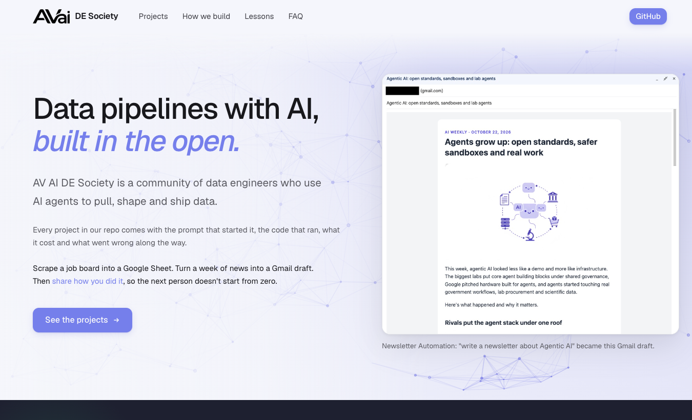
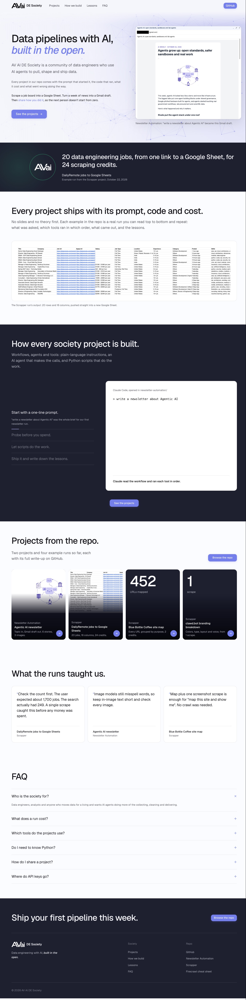

# Example: AV AI DE Society landing page (October 22, 2026)

A real run of Website Building, from a screenshot of a site to clone to a landing page for AV AI DE Society that shows off the other projects in this repo.



## The prompts

In Claude Code, opened in the repo, in this order:

1. > I want you to spin up a new website for us, get rid of the old one, and you can put this one on localhost. I basically want you to clone this website.

   With a full-page screenshot of yeldra.com and its CSS variables pasted in.
2. > What I want you to do now is work in our brand assets. So our brand guidelines and our AVai logo.
3. > work in this background behind hero text

   With a React fluid-simulation component (`dye-whorl.tsx`) pasted in.
4. > I want to change the content in website. I want the website to change to AV AI DE Society

   Claude asked what "DE" stands for (Data Engineering) and what the page should offer (a free community, with the projects in this repo as examples).
5. > also ignore our branding guidelines and use [the yeldra.com screenshot]
6. > use this hero and remove the pricing and joining society option from website

   With a React particles component (`particles-bg.tsx`, using particles.js) pasted in.

## What happened behind the scenes

### 1. Clone the layout

The reference screenshot was 1350×7220, too tall to read in one go, so it was cut into sections. Claude rebuilt each section in a single `index.html` with Tailwind from the CDN: header, hero with a screenshot on the right, a dark quote band, a four-step section, a strip of cards, three testimonial cards, a split pricing card, an FAQ and a dark footer.

Colors, the Geist font and spacing came from the pasted CSS variables (violet at hue 277, navy `#1e2030`, teal `#30a06a`). The copy and logo were not copied: the page uses the AVai logo and original text.

Two rounds of screenshots against the reference fixed the right edge of the content (the reference sits 49px from the right, not 64px), the hero image position, footer columns and a heading that wrapped badly.

### 2. Brand pass, then back to the reference

The "brand guidelines" PDF turned out to be a one-page cover of another company's guide, so only its look was borrowed: black and white, heavy grotesk headlines. Prompt 5 then reverted to the reference style, keeping the AVai logo.

### 3. Hero background

Both pasted components are React, but this site is static HTML, so neither was dropped into `/components/ui`. Each was ported to plain JavaScript inline in the page instead:

- **DyeWhorl** (prompt 3): a WebGL2 fluid solver. The paste was cut off at 50,000 characters, so the pointer handling, resize and cleanup at the end were rewritten. Replaced in step 6.
- **particles-bg** (prompt 6, the current hero): particles.js 2.0.0 from jsDelivr, with the component's settings recolored to the brand violet.

### 4. Content from the repo

Every section was rewritten from the example runs in this repo:

| Section | Source |
|---|---|
| Hero image | The Gmail draft from [the Agentic AI newsletter run](../../../newsletter-automation/examples/2026-10-22-agentic-ai/) |
| Stat band and main image | [The DailyRemote jobs run](../../../scrapper/examples/2026-10-22-dailyremote-data-engineering/): 20 jobs into a Google Sheet for 24 credits |
| How we build | The four steps the runs follow, each showing a real command and result |
| Projects | One card for each of the four example runs, linking to its write-up |
| Lessons | Quotes from the "Lessons from this run" sections |
| FAQ | Real costs and tools from the runs |

The Blue Bottle and clawd.bot cards show their numbers (452 URLs, 1 scrape) instead of screenshots, since those screenshots are of other companies' websites.

## The output

[`index.html`](../../index.html), served locally:

```bash
cd "website building"
python3 -m http.server 3000
```

| File | What's in it |
|---|---|
| [`screenshots/desktop-hero.png`](screenshots/desktop-hero.png) | The hero at 1350px wide |
| [`screenshots/desktop-full.jpg`](screenshots/desktop-full.jpg) | The whole page at 1350px wide |
| [`screenshots/mobile-hero.png`](screenshots/mobile-hero.png) | The top of the page at 390px wide |



## Lessons from this run

- **Headless Chrome won't go narrower than 500px.** A `--window-size=390,…` screenshot is a 500px layout cropped to 390px, which looks like a broken page. Load the page in a 390px iframe instead.
- **WebGL needs a flag in headless Chrome.** Use `--use-angle=swiftshader --enable-unsafe-swiftshader`, or the canvas stays blank.
- **`sips --cropOffset` is ignored when the offset is `0 0`**: the crop comes from the center. Use `1 1` for the top slice, or crop by rendering the image at a negative margin in a page.
- **A background behind text never gets the mouse.** particles.js listens on its canvas, which sits under the hero copy, so the hero forwards the pointer position to it.
- **Check what a "brand asset" is before using it.** The brand guidelines PDF belonged to a different company. It and the reference screenshot are kept out of git.
